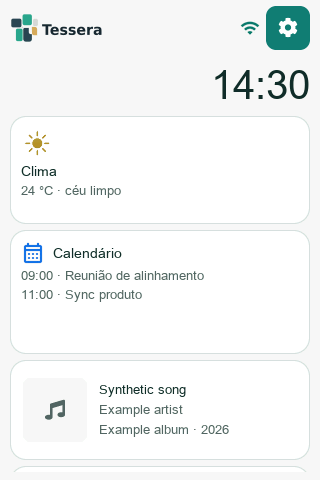

# Tessera

A small, open source desk display for the **JC3248W535 ESP32-S3**, with a Mac companion. See your clock, weather, agenda, music and AI usage without switching windows.

[Start using Tessera](https://gilsondev.github.io/Tessera/) · [Set up your device](docs/guides/device-setup.md) · [Contribute](CONTRIBUTING.md) · [Releases](https://github.com/gilsondev/Tessera/releases)



## Choose your starting point

- **I have a panel:** follow [device setup](docs/guides/device-setup.md), install the Mac Agent, then choose your integrations.
- **I want to try or contribute without hardware:** follow [developer setup](docs/getting-started.md). The simulator uses the firmware UI sources.
- **I want to add a widget:** read the [architecture](docs/guides/architecture.md) and [widget guide](docs/guides/widget-authoring.md).

## What works

Clock and weather run on the panel. The Mac Agent sends calendars already added to macOS, Spotify/Apple Music metadata, Focus status, AI usage and Todoist snapshots over USB. The local web portal configures the device over Wi‑Fi.

Music and Focus are **informational**. Change playback and Focus on the Mac. Album artwork is acknowledged and retried over USB; album/year are shown when supplied by the player (Spotify's scripting interface does not supply a year).

The Agent is currently for macOS; release CI builds Apple Silicon. It is not signed/notarized yet. Calendar integration uses the native macOS permission and the accounts already added to the Mac. Tessera only reads the selected calendars; see [Calendar setup](docs/guides/calendar-setup.md).

## Run without a panel

```sh
# macOS; Linux packages are listed in docs/getting-started.md
brew install cmake ninja pkg-config sdl2 freetype python3
./tools/bootstrap-env.sh
make finish-host
make sim
```

For the Rust daemon and Mac app, see [Agent development](docs/guides/agent-v2-dev.md).

## Project map

| Directory | Purpose |
| --- | --- |
| `firmware/widgets/` | Independent widget packages |
| `firmware/components/` | Widget SDK, runtime, UI kit and platform services |
| `simulator/` | Firmware UI on SDL, fixtures and user journeys |
| `agentd/` | Rust daemon, native calendar access, USB and integrations |
| `apps/agent-ui/` | Mac setup and daily configuration |
| `web/` | Local device configuration portal |
| `site/` | Public introduction and installation guide |
| `docs/` | User guides, contributor guides and design history |

## Verify a change

Run `make test`, then `make e2e` and inspect `$SIM_OUT` (default `/tmp/tessera-sim-out`). With a board, continue with `make flash` and `make device`. Browser journeys and hardware automation are described in [testing](docs/guides/testing.md).

Do not commit credentials, local builds or private device captures. See [repository assets](docs/guides/repository-assets.md). Licensed under [Apache 2.0](LICENSE); third-party notices are in [NOTICE](NOTICE).
